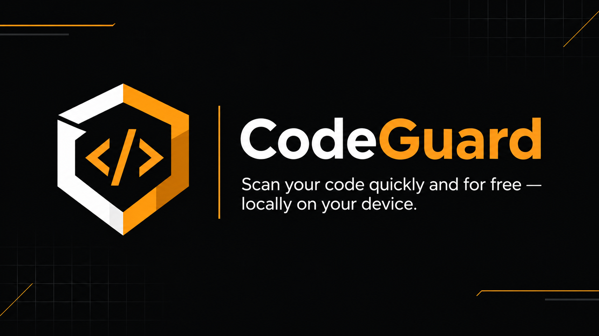
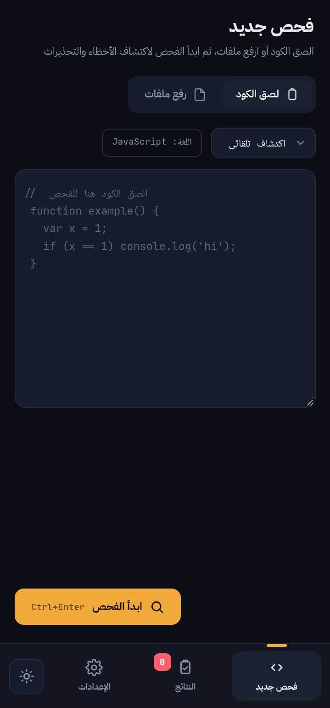

<h1>CodeGuard</h1>

<b>Lightweight code analysis tool for detecting common issues locally.</b>

  

## 📖 About

CodeGuard is a lightweight code analysis tool designed to help developers identify common code issues through a simple and organized interface. It supports multiple programming and markup formats, provides issue details, and helps developers review their code more efficiently. The core checks run locally in the browser, while some advanced analysis features may require an internet connection.

## 📸 Screenshots

  

## ✨ Features

- ✨ **Local code analysis in the browser**
- 🚀 **Support for HTML, CSS, JavaScript, JSON, and PHP checks**
- 🧩 **Issue detection with severity levels and line numbers**
- 🛠️ **Quick and deep analysis modes**
- 💡 **Code issue reports and export options**
- 🎨 **Clean interface with dark and light themes**
- 🎯 **No dedicated backend server required for core checks**

## 🚀 Getting Started

1. Download or clone the repository.
2. Open CodeGuard.html in a modern web browser.
3. Paste your code or upload a supported file.
4. Choose quick or deep analysis.
5. Review the detected issues and export the results if needed.

## 🛠️ Built With

      

## 🔗 Links

## 📄 License

All rights reserved.

---

⭐ If you like this project, consider giving it a star!

Made with ❤️ by [@r-c-a-16](https://github.com/r-c-a-16)

